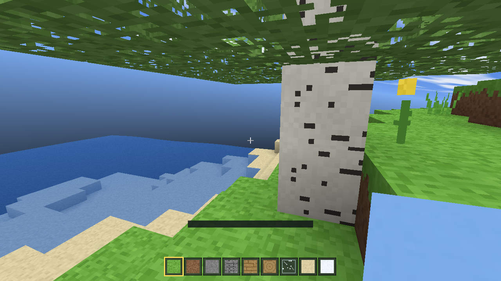

# MC-RS — a Minecraft clone, written in Rust

A from-scratch voxel game in the spirit of **Minecraft Java Edition**: an endless
procedurally generated world, block breaking and placing, mining, day/night
cycles, water, caves, ore veins, trees, biomes, ambient occlusion lighting,
first-person physics, an inventory hotbar, a block palette and a save file.

It runs **natively** (winit + wgpu) and **in the browser** (the same Rust code
compiled to WebAssembly, rendering through WebGL2).



*An unmodified frame of the renderer, captured by the automated GPU test
(`crates/client/tests/gpu_smoke.rs`) on a software Vulkan driver — terrain,
beach, ocean, a birch trunk, a tree canopy, a cactus, a pig, a cow, a sheep,
hearts, hunger and the hotbar, all drawn by the code in this repository.*

```
crates/
  voxel/    game simulation: world gen, meshing, physics, inventory, HUD — no I/O
  client/   wgpu renderer + platform independent game loop
  desktop/  native binary (winit)
  webapp/   wasm-bindgen entry point
web/        HTML/JS shell (pointer lock, autosave, frame loop)
```

## Features

**World**
- Infinite terrain from a deterministic seed: continents, hills, ridged
  mountains, oceans, beaches, plains, forests, deserts, snowy tundra.
- 3D-noise cave systems plus deep caverns, coal/iron/gold/diamond veins in
  depth-dependent layers, bedrock floor.
- Oak, birch and spruce trees, cacti, tall grass, poppies, dandelions, snow
  caps, frozen oceans.
- 32 block types, including glass, leaves, water, ice, bricks, bookshelves and
  glowstone.
- Chunks stream in and out around the player, edits persist even after a chunk
  is unloaded.

**Rendering**
- Hand-written [wgpu](https://wgpu.rs) renderer with WGSL shaders, running on
  Vulkan/Metal/DX12 natively and WebGL2 in the browser.
- Face-culled chunk meshes with per-vertex Minecraft-style ambient occlusion
  and directional face shading.
- Separate opaque, alpha-tested (leaves, glass, plants, particles, crack
  overlay) and translucent water passes.
- Procedural sky: gradients, sun, moon, twinkling stars, drifting clouds,
  sunset colours, underwater fog and tint.
- Procedural 512×512 texture atlas — **no binary assets**, every block texture
  and the pixel font are painted in code at start-up.
- Frustum culling, view-model hand animation, block outline and crack overlay.

**Creatures & survival**
- Eight mobs with their own models, skins, physics and AI: pigs, cows, sheep
  and chickens wander and flee when hit; zombies chase and punch, skeletons
  shoot from range, creepers hiss and blow craters in the terrain, spiders
  scuttle fast and leap.
- Minecraft style spawning: animals appear on grass in daylight, monsters in
  the dark; undead burn in the sun; mobs despawn when you leave them behind.
- Survival mode with 10 hearts, a hunger bar, saturation, natural
  regeneration, starvation, drowning, fall damage, knockback, damage
  cooldowns and a death / respawn screen.
- Creative mode with flight, instant mining and unlimited blocks (`G`
  switches).

**Gameplay**
- First-person movement with AABB collision, sprinting, sneaking, jumping,
  swimming, and creative flight.
- Break progress driven by block hardness; survival mode collects blocks,
  creative mode is instant and infinite.
- 9 slot hotbar, block palette (E), pick block (middle mouse), mouse wheel.
- Punch mobs with the left mouse button; hearts and hunger sit above the
  hotbar in survival mode. `R` respawns after death.
- Day/night cycle with a clock, biome readout and an F3 debug overlay.
- Block-break particles, and autosaving to disk (desktop) or `localStorage`
  (browser).

## A note on textures

No Mojang assets are used or redistributed here: the 512×512 atlas is painted
procedurally in `crates/voxel/src/textures.rs` at start-up (16×16 pixel art per
block, plus hand-drawn mob skins, hearts and hunger icons) to match the
familiar vanilla look. Shipping the official texture files would mean
redistributing Mojang's copyrighted artwork.

## Build status

Everything below is built and tested by GitHub Actions on every push:

| Job | What it does |
| --- | --- |
| `native (linux)` | `cargo check --workspace --all-targets`, `cargo test` (38 unit tests + a headless GPU render test), `cargo build --release -p mc-desktop` |
| `wasm (webgl2)` | `wasm-pack build crates/webapp --target web --release` into `web/pkg` |
| `publish build output` | commits the logs (`ci/`) and the WebAssembly bundle (`web/pkg/`) back to the branch |

The **headless GPU test** (`crates/client/tests/gpu_smoke.rs`) creates a real
wgpu device on Mesa's software Vulkan driver, builds every pipeline, renders
a frame of a generated world into an offscreen texture, reads the pixels back
and asserts that the image actually contains sky and terrain geometry. That
catches WGSL errors, bind-group/vertex-layout mismatches and attachment
incompatibilities on CI machines without a GPU.

## Running natively

Requires a stable Rust toolchain (1.75+).

```bash
cargo run --release -p mc-desktop
```

The world is saved to `mc_world.dat` in the working directory (F5 saves, F2
reloads, F11 toggles fullscreen).

## Running in the browser

```bash
rustup target add wasm32-unknown-unknown
cargo install wasm-pack          # or use the official installer script
wasm-pack build crates/webapp --target web --release --out-dir ../../web/pkg --out-name mc
python3 -m http.server 8080 --directory web
# open http://localhost:8080
```

`web/pkg` is a build artefact and is not checked in by hand — CI refreshes it.

## Controls

| Input | Action |
| --- | --- |
| `W A S D` | move |
| mouse | look |
| `Space` | jump / swim up / fly up |
| `Shift` | sneak / fly down |
| `Ctrl` | sprint |
| left mouse | break block (hold to mine) |
| right mouse | place block |
| middle mouse | pick block |
| `1`–`9`, wheel | select hotbar slot |
| `E` | block palette |
| `F` | toggle creative flight |
| `G` | switch survival / creative |
| `F3` | debug overlay |
| `R` | respawn |
| `Esc` | release the mouse |

## Tests

The simulation crate is dependency-light and fully unit tested (terrain
determinism, height maps, physics, ray casting, meshing, save round-trips):

```bash
cargo test --workspace
```

## How it works

- `voxel::world` stores chunks in a `HashMap`, applies a persistent edit map on
  top of generated terrain, and tracks dirty chunks for remeshing.
- `voxel::mesher` walks each chunk, emits only visible faces, samples the three
  neighbouring blocks around every face corner for ambient occlusion and splits
  geometry into opaque / cutout / water buffers.
- `voxel::physics` does sub-stepped, axis-by-axis AABB collision against the
  voxel grid; `voxel::raycast` is an Amanatides–Woo DDA for block selection.
- `mc-client::renderer` uploads chunk meshes into GPU buffers a few per frame,
  culls them against the view frustum and draws everything in a single render
  pass.

## Roadmap

Not implemented yet: crafting, mobs, redstone, multiplayer, torches/light
propagation, sound. The architecture leaves room for all of them — world
generation, simulation and rendering are cleanly separated.

## License

MIT.
